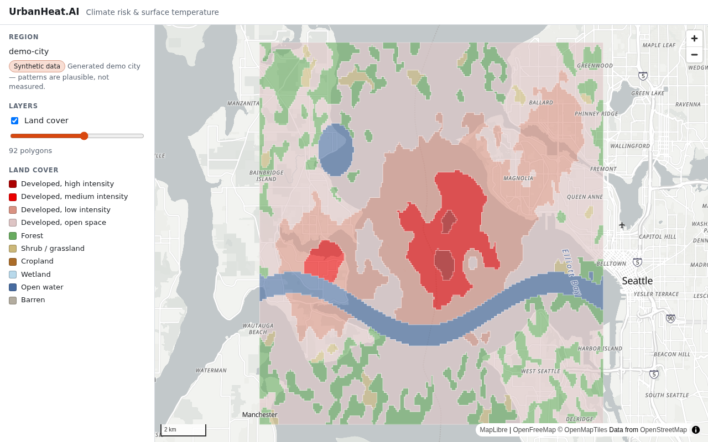
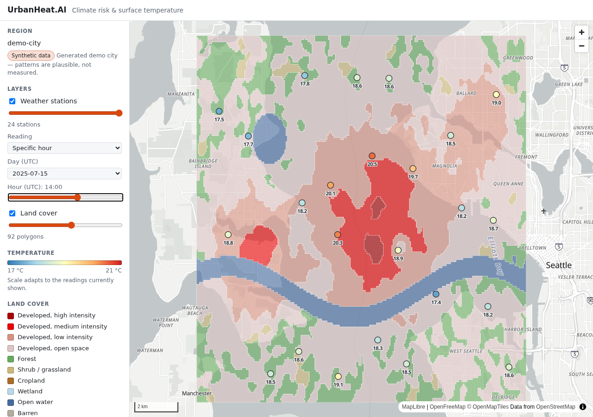
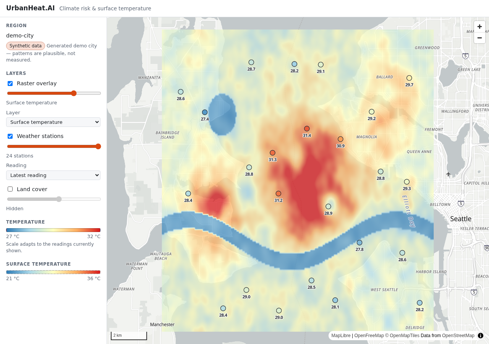

# apps/web

Next.js 16 (App Router) app: the Node backend (route handlers under `app/api`) and the MapLibre UI. Spatial logic lives in `packages/geo-core`, which `predev` /
`prebuild` compile before Next starts.

```bash
npm run dev -w @urbanheat/web          # http://localhost:3000
npm run typecheck -w @urbanheat/web
npm test -w @urbanheat/web             # 80 tests; DB-backed ones report "skipped" if the demo city isn't loaded
```

> Next 16 differs from older versions; `AGENTS.md` points at the bundled docs in
> `node_modules/next/dist/docs/` (generated by `next dev`, committed per its own note).

## Environment

Read from the repo-root `.env` (`next.config.ts` loads it; Next itself only looks in this folder).

| Var | Meaning |
|---|---|
| `APP_DATABASE_URL` | Postgres URL for the **read-only** `urbanheat_ro` role. The API never writes. |
| `RASTER_DIR` | GeoTIFF directory. Relative values resolve against the repo root; `next.config.ts` turns it into an absolute path (server code can't do `process.cwd()` math without Turbopack tracing the whole project). |

`lib/env.ts` validates these on first use and reports every problem at once.

## Data API (Session 7)

All endpoints are `GET` unless noted, return JSON, and reject bad input with `400`
(`{ error, details }`). Unexpected failures return a generic `500` and are logged server-side only.
Responses are not cached. Region names are slugs (`demo-city`).

### `GET /api/landcover`
Land cover polygons as a GeoJSON `FeatureCollection` (plus `truncated: boolean`).

| Param | |
|---|---|
| `bbox=w,s,e,n` | **required** |
| `region` | optional slug |
| `class=forest,water` | optional subset of `developed_high, developed_medium, developed_low, developed_open, forest, shrub_grass, cropland, wetland, water, barren` |
| `simplify=0.0005` | Douglas-Peucker tolerance in degrees (0–0.1) for zoomed-out views; default exact |
| `limit` | 1–5000, default 1000 |

Feature properties: `id, region, class, canopy_pct, impervious_pct, area_m2`.

### `GET /api/stations`
Stations as GeoJSON points with a temperature reading. Pick the reading with **one of**:
`at=2025-07-15T22:00:00Z` (exact timestamp) · `date=2025-07-15&agg=max|mean|min` (UTC day;
`agg` defaults to `max`) · neither (each station's latest reading).
Also `bbox`, `region`, `observed_only=true` (drop stations with no reading), `limit`.
Properties: `station_id, name, region, elevation_m, source, temp_c, humidity_pct, wind_ms,
observed_at (null for date aggregates), n_obs`. Stations without a reading have `temp_c: null`.

### `GET /api/stations/range?region=`
What readings exist: `{ region, stations, observations, first, last, days: ["2025-07-15", ...] }` (UTC days with
data). The UI offers only days that have readings.

### `GET /api/raster/layers[?region=]`
The raster catalog: `name, region, kind, unit, width_px, height_px, nodata, bbox, description`.

### `GET /api/raster/tile/{region}/{kind}/{z}/{x}/{y}.png`
A 256x256 PNG tile (Web Mercator, XYZ) of a raster layer, rendered on the fly from its GeoTIFF with the layer's
color ramp. `kind` is `lst`, `canopy`, `impervious` or `elevation`. Tiles outside the raster are a shared,
fully transparent 334-byte PNG. Responses carry `Cache-Control: public, max-age=300, stale-while-revalidate=3600`
and a weak `ETag` (file mtime + size + tile), so matching `If-None-Match` gets a bodyless `304`.
`400` bad tile coordinates, `404` unknown region/kind, `422` tile too large to render on the fly, `503` GeoTIFF missing.

Server-side details (`lib/raster-tiles.ts`): an in-memory LRU of 400 rendered tiles; a color domain per layer computed
once from a 512 px overview (percent layers use a fixed 0–100); catalog rows cached 30 s; every cache key includes the
file's mtime, so re-ingesting a region (new GeoTIFF) invalidates its tiles, domains and ETags automatically.

### `GET /api/raster/legend?region=&kind=`
The ramp the tile endpoint uses: `{ kind, unit, domain: [lo, hi], stops: [{ value, color, alpha }] }`, so the UI legend
is always the same ramp as the pixels.

### `GET|POST /api/raster/stats`
Coverage-weighted statistics of each raster layer (`canopy`, `impervious`, `lst`, `elevation`) inside an area:

- `GET ?region=demo-city&point=-122.45,47.625&radius_m=800[&layers=lst,canopy]`
- `GET ?region=demo-city&bbox=w,s,e,n`
- `POST { region, layers?, geometry: Polygon | MultiPolygon, supersample? }` for a drawn polygon (≤ 10 000 vertices)

```json
{ "region": "demo-city", "areaM2": 2009811.9,
  "layers": { "lst": { "name": "demo-city-lst", "unit": "celsius", "mean": 36.35, "min": 32.25, "max": 38.34,
                        "std": 1.32, "cells": 384, "weight": 347, "nodataShare": 0, "areaM2": 2009811.9 } } }
```

`radius_m` ≤ 20 000. Statistics are `null` (never `NaN`) when every cell in the area is no-data.
Errors: `404` unknown region/layer or area outside the rasters, `422` area too large to read,
`503` catalog row whose GeoTIFF is missing on disk (the path is logged, not returned).

## Map UI (Session 8)



`app/page.tsx` discovers regions from `/api/raster/layers`, fits the map to the first region's bbox, and
draws land cover polygons from `/api/landcover` styled with the NLCD legend. The sidebar has the region
(with a "Synthetic data" badge for generated regions), a land cover toggle and opacity slider, a live
status line with **Retry**, and the legend. Clicking a polygon shows class, canopy %, impervious % and area.
Below 720 px wide the sidebar moves under the map.

```
components/MapView.tsx      map lifecycle: controls, resize, basemap fallback; hands the live map to onReady
components/Sidebar.tsx      controls + legend
lib/map/landcover-layer.ts  attachLandCover(map, opts): source + fill/line layers, loading, hover, popup, destroy()
lib/map/landcover.ts        pure helpers: class colors, zoom -> simplify tolerance, request URL, popup text
lib/map/geo.ts              bbox helpers (viewport clamping, padding, containment)
lib/useRegions.ts           region list from the raster catalog
```

Design notes (each was checked in a real Chrome via Playwright, not just typechecked):

- **Fetching is viewport-driven but cheap.** `moveend` is debounced (250 ms); the request covers the view
  padded by 25 %, so small pans don't refetch (a 10 px drag made 0 requests). A new request happens only when
  the view leaves the loaded box or the integer zoom changes; the in-flight request is aborted when superseded.
- **Geometry is simplified for the zoom** (about half a screen pixel via the API's `simplify`), and exact below ~2 m.
- **Truncated responses aren't cached as "loaded"** — the status says "zoom in to see all", and the next move retries.
- **Layers sit under the basemap's labels** (inserted before the first `symbol` layer).
- **Basemap offline?** A style failure before first load swaps to a blank background so data layers still work.
- **MapLibre v6 has only named exports**, and Turbopack doesn't rewrite its worker URL, so
  `scripts/copy-maplibre-worker.mjs` copies the worker into `public/maplibre-gl/` (gitignored, regenerated on
  install/dev/build) and `MapView` points `setWorkerUrl` at it. Without it every map logs "Worker failed to load".
- Popups are built with DOM `textContent`, never `innerHTML`.
- The synthetic demo city's coordinates sit over real Puget Sound geography, so its river and lake don't match
  the basemap's water. That is expected; it is why the sidebar flags the data as synthetic.

## Stations, reading modes, and layer controls (Session 9)



Weather stations are circles colored by temperature, labelled with the value from zoom 11, with a hover ring and
a click popup (name, time or day summary, temperature, humidity, wind, elevation, source). Stations with no
reading for the chosen time show as gray "No reading" circles instead of disappearing.

**Reading selector** (under the stations layer): *Latest reading*, *Specific hour* (day + UTC hour slider), or
*Daily summary* (max / mean / min over a UTC day). Days come from `/api/stations/range`. Changing it refetches
`/api/stations` with `at=` or `date=&agg=`, closes any open popup (its text described the old reading), and the
state survives hiding and re-showing the layer.

**Color scale** is a reversed ColorBrewer RdYlBu ramp (blue → pale yellow → red; blue-vs-red rather than
red-vs-green, so it stays readable under common color-vision deficiencies). Its domain is computed from the readings
shown (rounded to whole degrees, at least 4 °C wide), so a cool morning and a hot afternoon both use the full ramp.
The legend states that the scale adapts, so two hours are compared by number, not by color alone.

**Layer toggle list** (`LayerToggleList`): one row per layer with a checkbox, an opacity slider, a live status line
(with Retry on failure), and optional extra controls; legends appear only for visible layers. Adding a layer in a
later session means adding an item, not editing the sidebar.

Other notes:

- Stations load the whole region once per reading mode (tens to a few thousand points), unlike land cover, which is
  viewport-chunked. If a real region exceeds the 5000-station cap the response is flagged `truncated`.
- Popups share one manager (`lib/map/popup.ts`): clicking a station on top of a polygon opens only the station's popup
  (land cover defers when a station is under the cursor), and a new click replaces the old popup rather than stacking.
- Value labels need basemap glyphs; the offline fallback style has none, so labels are skipped there.
- Controls carry explicit `aria-label`s (a `<label>` wrapping a `<select>` otherwise includes every option's text in
  its accessible name).

```
components/LayerToggleList.tsx   generic layer rows            components/ReadingControls.tsx  latest / hour / daily
components/Legend.tsx            temperature + land cover      lib/map/stations-layer.ts       attachStations(map, opts)
lib/map/temperature.ts           ramp, niceDomain, expressions lib/map/stations.ts             modes, URLs, popup text
lib/useStationsRange.ts          /api/stations/range hook      lib/map/popup.ts                one shared popup per map
```

## Raster overlay (Session 10)



A **Raster overlay** row in the layer list (off by default) with a layer picker: *Surface temperature*, *Tree canopy*,
*Impervious surface*, *Elevation*. It is a MapLibre `raster` source pointing at `/api/raster/tile/...`, restricted to
the region's bounds, drawn beneath land cover, stations and the basemap's labels. The legend comes from
`/api/raster/legend`, with a checkerboard behind it where a ramp is transparent.

- **Lazy:** while the layer is hidden MapLibre requests no tiles (verified: 0 requests on load and while panning hidden).
- **Switching layers** swaps the source's tile URL in place (`setTiles`) rather than rebuilding the map layer.
- **Failures:** a tile error shows "Some tiles failed to load" with **Retry**.
- **Two temperature scales:** the station legend adapts to the readings shown (e.g. 27–32 °C), while the raster legend
  spans the layer's 2nd–98th percentile (e.g. 21–36 °C). They are labelled separately; compare by number, not by color.
- **Timing** (production build, demo city): first tile ~130 ms (includes the color-domain pass), further fresh tiles
  ~20–35 ms, a cached tile ~4 ms, a `304` ~3 ms; 30 sequential z13 tiles averaged 18 ms.
- Tiles are 40–85 KB at z12–13 because smooth gradients don't compress well as 32-bit PNG; paletted PNG would shrink
  them but isn't implemented.

## Layout

```
app/api/*/route.ts     thin handlers: parse -> query -> JSON, wrapped in handle()
lib/http.ts            ApiError, parseQuery/parseBody (zod), handle()
lib/schemas.ts         bbox / point / region validators
lib/queries/*.ts       parameterized SQL builders + row mappers (unit-tested without a DB)
lib/raster-stats.ts    catalog lookup + geo-core zonal stats, with injectable dependencies
lib/{env,db,rasters}.ts  validated env, one pg Pool, one RasterStore per process
```

## Verified against

Unit tests (SQL text/params, validation, mapping, error paths against geo-core's fixtures),
integration tests on the live demo city, and the running server in both `next dev` and
`next build && next start`. A drawn-polygon mean temperature (31.396 °C over 8 640 cells)
matches an independent rasterio computation exactly.
